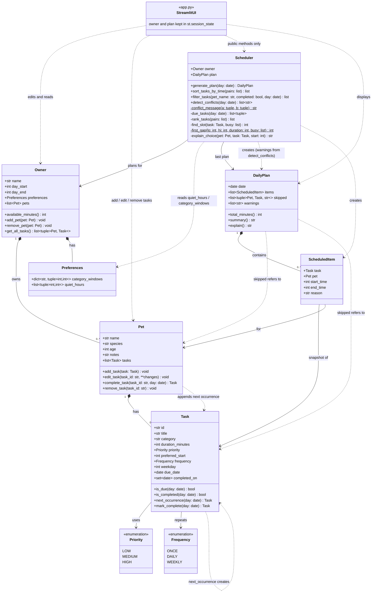

# PawPal+ UML Class Diagram

Times are stored as minutes since midnight. Source of truth for the diagram is `diagrams/uml.mmd`.

## Notes
- **Owner** defines the day window (`day_start`-`day_end`) and holds typed **Preferences** (per-category time windows, quiet hours). `get_all_tasks()` returns `(Pet, Task)` pairs so the pet is never lost.
- **Task** is validated on creation (duration > 0, valid times, weekday required for weekly). Recurrence is modeled with `Frequency`; each recurrence is its own `Task`. `mark_complete` records the date and returns the next occurrence (new id, new `due_date`), which `Pet.complete_task` appends to the pet.
- **Pet** manages its tasks: add (rejects duplicates), edit (re-validated through `dataclasses.replace`), complete and remove.
- **Scheduler** produces one sequential plan across all pets (the owner does one thing at a time). Ranking: priority, then preferred start, then shortest duration. It also offers `sort_tasks_by_time`, `filter_tasks` and `detect_conflicts`, which only report overlapping preferred times and never change the plan. Private helpers are shown with `-` (`$` marks static ones). The last plan is kept on `Scheduler.plan`.
- **ScheduledItem** holds a reference to the task at planning time. Editing a task replaces it in `pet.tasks`, so an existing plan keeps the old object and is stale.
- **DailyPlan** lists skipped tasks with the reason each was skipped and carries `warnings` from conflict detection.
- **StreamlitUI** (`app.py`) is a client, not part of the domain model. It calls only the public methods, keeps the `Owner` and latest plan in `st.session_state`, and clears the plan after a task is edited or removed.
