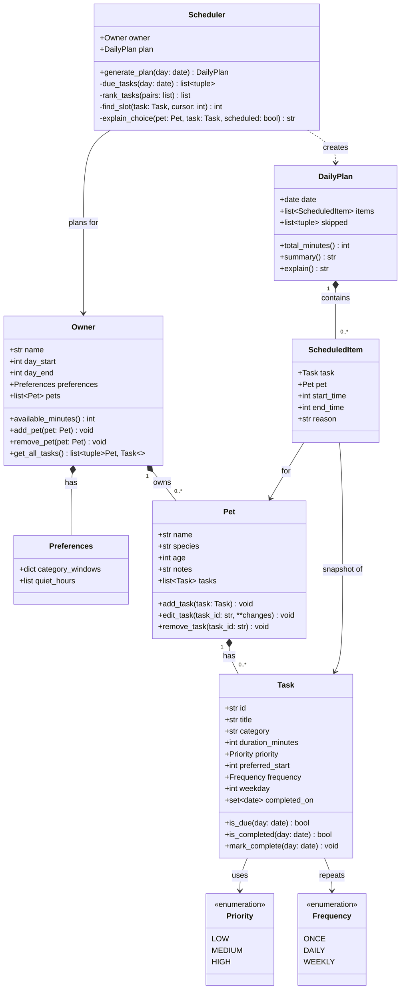

# PawPal+ UML Class Diagram

Times are stored as minutes since midnight.

## Notes
- **Owner** defines the day window (`day_start`–`day_end`) and holds typed **Preferences** (per-category time windows, quiet hours). `get_all_tasks()` returns `(Pet, Task)` pairs so the pet is never lost.
- **Task** is validated on creation (duration > 0, valid times, weekday required for weekly). Recurrence is modeled with `Frequency`; completion is tracked per date in `completed_on`.
- **Scheduler** produces one sequential plan across all pets (the owner does one thing at a time). Ranking: priority, then preferred start, then shortest duration. The last plan is kept on `Scheduler.plan`; the Streamlit app should hold the `Owner`/`Scheduler` in `st.session_state`.
- **ScheduledItem** is a snapshot; editing a task later does not change an existing plan.
- **DailyPlan** lists skipped tasks with the reason each was skipped.
